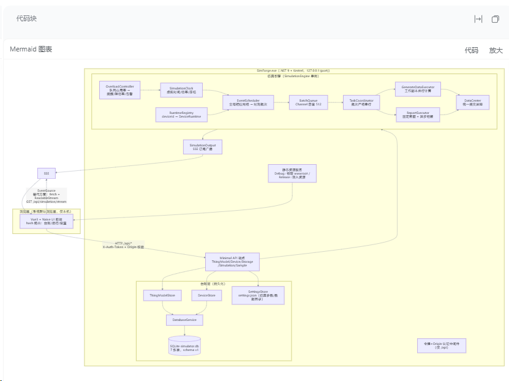
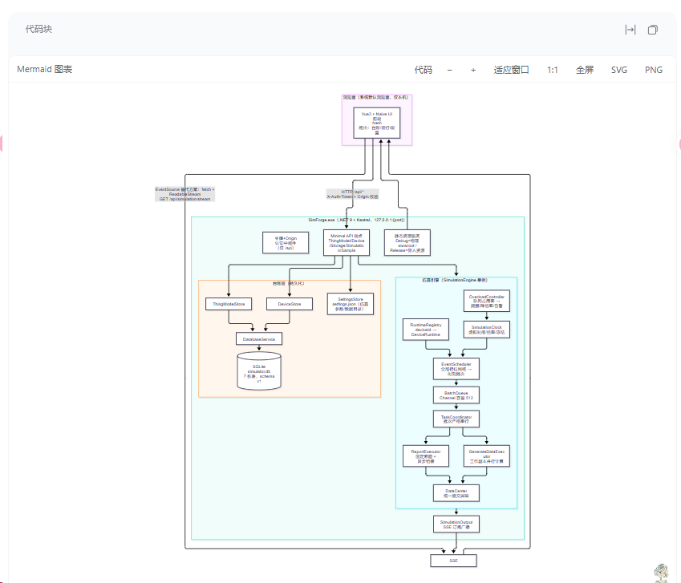
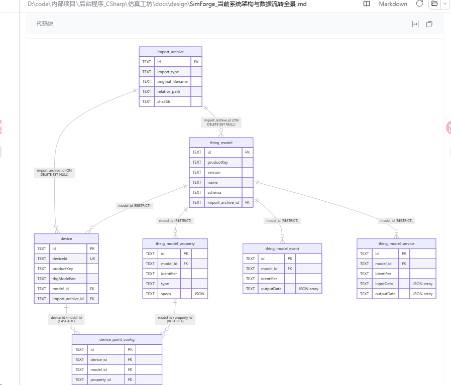
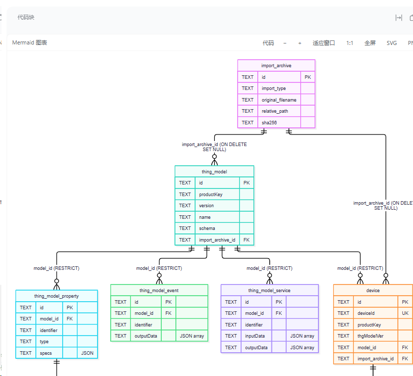
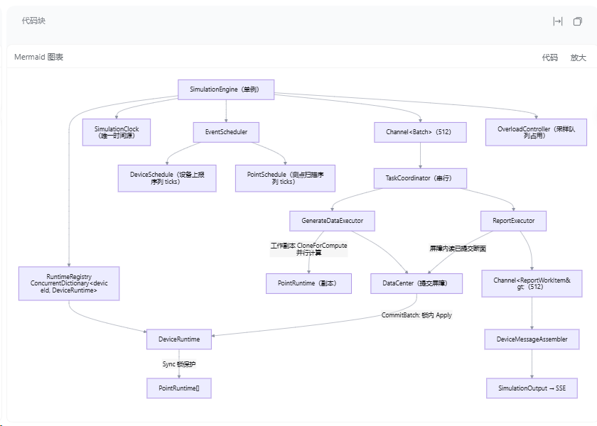
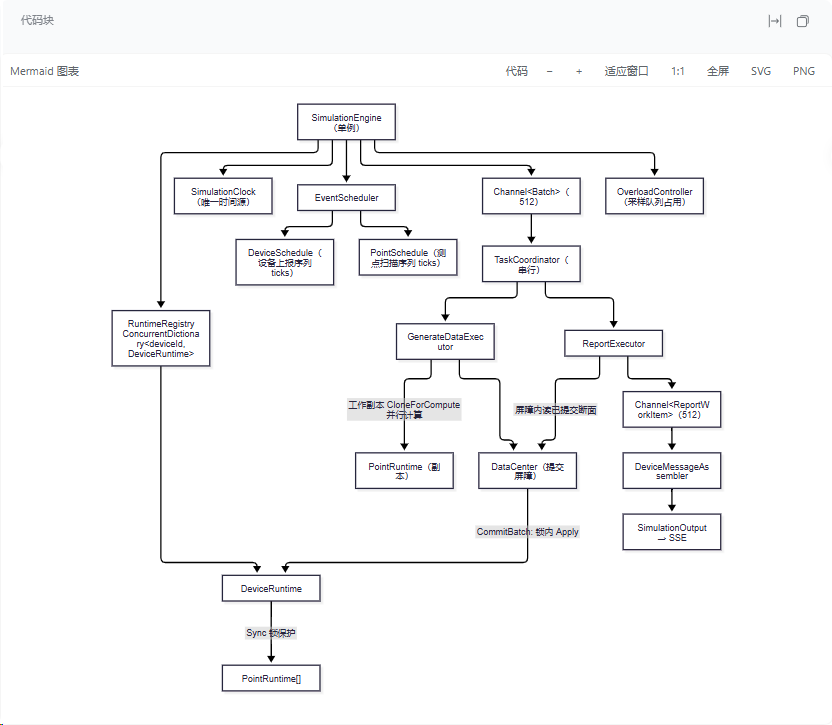
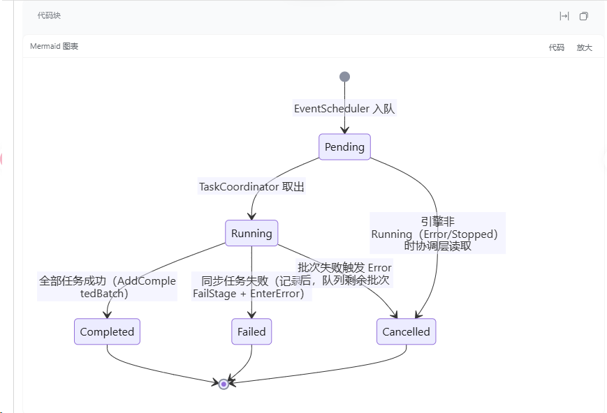
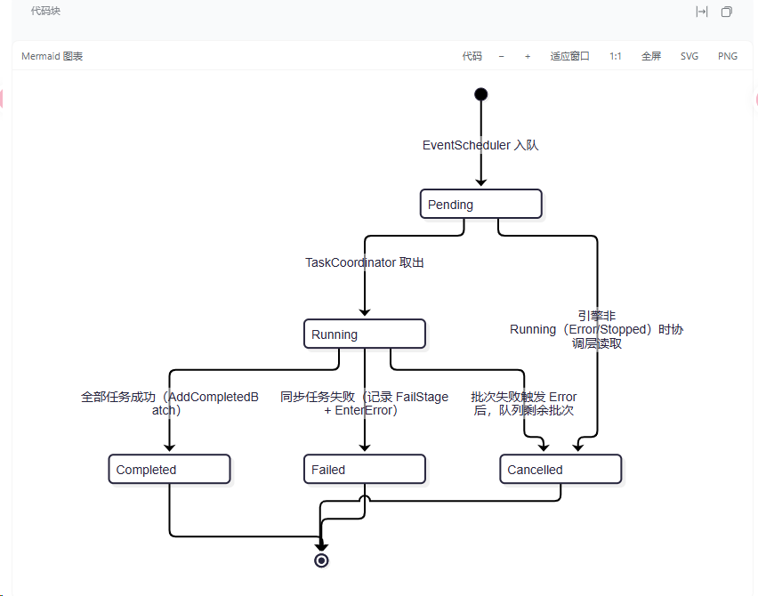

# dsh-mermaid-plus

[](https://www.npmjs.com/package/dsh-mermaid-plus)
[](LICENSE)
[](https://github.com/deepseek-ai/DeepSeek-Harness)
[](#install)

Mermaid diagrams for [DeepSeek Harness](https://github.com/deepseek-ai/DeepSeek-Harness) — rendered automatically by default, with inline zoom, drag to pan, fullscreen viewing, and SVG/PNG export.

[中文说明](#中文说明)

## Fork 来源与本次改造

本项目 Fork 自 **[pidongqianqian/dsh-mermaid-plus](https://github.com/pidongqianqian/dsh-mermaid-plus)**，原作者为 **pidongqianqian**，沿用 MIT 许可证。当前 Fork 为 [Songyanglin-curious/dsh-mermaid-plus](https://github.com/Songyanglin-curious/dsh-mermaid-plus)。上游提供了 DSH 集成、图表识别、三种渲染模式、源码切换、全屏查看、缓存及生命周期管理；本次在这些功能基础上改造渲染核心和图形交互。

当前本地验证版为 **`0.3.0-local.3`**，尚未发布到 npm；上方 npm 徽章及 npm 包名指向上游发行版，不代表本 Fork 的改造版本。

| 改动 | 本 Fork 的行为 |
| --- | --- |
| 渲染核心 | Mermaid 从 11.17.0 升级并固定为 **12.2.0 完整版**，离线打包内置 ELK，不依赖 CDN。 |
| 布局与风格 | 默认 **ELK + Neo**，浅色使用 **Redux Color**，深色使用 **Redux Dark Color**；不再用 DSH 自定义节点配色覆盖官方主题。 |
| 默认展示 | 源码稳定后自动渲染并展示图形，仍保留手动、滚动可见、立即三种模式和代码切换。新版首次使用不继承旧版默认手动偏好。 |
| 卡片工具栏 | 增加缩小、放大、适应窗口、1:1、全屏、SVG 和 PNG 导出。 |
| 鼠标操作 | 图形区域内滚轮围绕指针缩放，左键拖拽平移；区域外仍正常滚动页面。 |
| 显示与生命周期 | 按 SVG 原始比例设置占位尺寸，限制预览高度；缓存加入渲染配置版本，拒绝源码更新或卸载后的过期异步结果。 |
| 构建与安全 | esbuild JS API 兼容 Windows，保留 strict 安全模式和纯 SVG 标签；附带 Mermaid 与 ELK 许可证。 |

保留现有 DSH 插件架构，没有修改 DSH 核心，也没有通过改写用户 Mermaid 源码调整布局。不同图表的布局结果仍取决于图形结构和 Mermaid 配置，并非所有图形都会变得更小。

---

## 渲染效果对比

以下为本机 DSH 中的实际截图：左侧为上游原版 **0.2.6**，右侧为本 Fork **0.3.0-local.3**。每组展示对应图表的改造前后效果。截图的视口、缩放和裁切范围不完全一致，用于观察布局、配色与工具栏差异，不作等比例尺寸或性能比较。

### 系统架构图

复杂嵌套子图从横向展开转为较集中的纵向层次，浏览器、台账层和仿真引擎的边界更容易辨认。

| 上游原版 | 本次改造 |
| --- | --- |
|  |  |

### 实体关系图

实体采用分组配色，关系连线和基数标记使用新的布局与视觉风格。此组截图仅展示局部，右侧部分内容被视口裁切。

| 上游原版 | 本次改造 |
| --- | --- |
|  |  |

### 仿真引擎图

调度、执行、提交和输出链路改用正交连线，分支与汇合关系呈现为更明确的执行层次。

| 上游原版 | 本次改造 |
| --- | --- |
|  |  |

### 状态图

状态节点、转换标签和终止状态采用新的样式与路径布局；改造版截图同时展示了卡片工具栏。

| 上游原版 | 本次改造 |
| --- | --- |
|  |  |

点击图片可查看原图。截图原件保存在 [docs/comparison](docs/comparison/index.md)，未重绘或修改图中内容。

## What it does

A fenced ` ```mermaid ` block in the conversation (or in a Markdown file preview) becomes a card:

- **On demand** — the source stays visible and a `Diagram` button waits in the card header. The offline Mermaid runtime is loaded only when requested.
- **When visible** — a diagram renders the first time its card scrolls into view.
- **Always (default)** — renders when the source settles, then displays the diagram. The new preference key resets the previous default manual mode once; subsequent choices are saved.

The inline toolbar offers −, +, fit, 1:1, fullscreen, SVG, and PNG. Use the wheel inside the diagram viewport to zoom around the pointer, and left-drag to pan. Outside the viewport, the wheel scrolls the page normally. SVG preserves natural dimensions; PNG uses the current background with a maximum long edge of 8192 pixels.

Every rendered diagram can be opened **fullscreen** with zoom and pan, which is the point: a wide flowchart squeezed into the message column is unreadable, while the same diagram at natural size is fine.

## Features

- Renders `mermaid`, `mermaidjs`, `mmd` and unlabelled blocks that start with a diagram keyword.
- Supports the diagram types the bundled Mermaid build ships: `flowchart`/`graph`, `sequenceDiagram`, `classDiagram`, `stateDiagram`, `erDiagram`, `gantt`, `pie`, `mindmap`, `journey`, `timeline`, `quadrantChart`, `xychart`, `gitGraph`, `requirementDiagram`, `C4`, `block-beta`, `packet-beta`, `sankey-beta`, `kanban`, `architecture-beta`, and more.
- **Theme-aware**: uses official Redux Color / Redux Dark Color themes based on the app's light/dark mode; palette changes invalidate rendered diagrams.
- **Streaming-safe**: a block is handed to Mermaid only after its source settles, so a half-written fence never flashes a parse error.
- **Cached**: a rendered diagram is kept by source + palette, so switching between Code and Diagram, or reopening the viewer, costs nothing.
- **Fullscreen viewer**: wheel zoom, drag to pan, double-click to fit, `Esc` to close, focus-trapped dialog, restores focus and page scrolling.
- Falls back to the visible source with a short error line when a diagram does not parse.
- Unmounting restores every code block to its original place in the transcript.

## Install

### 直接安装本 Fork（推荐）

从 GitHub 安装本仓库的改造版，以 `code` Profile 为例：

```sh
dsh plugin --profile code add github:Songyanglin-curious/dsh-mermaid-plus#main
```

仓库已包含离线 Mermaid 运行时，无需另外构建。将 `code` 替换为你实际使用的 Profile 名称；安装后重启该 Profile，并刷新浏览器页面。

如果该 Profile 已安装同名插件（上游版或旧本地包），先移除再安装：

```sh
dsh plugin --profile code remove dsh-mermaid-plus
dsh plugin --profile code add github:Songyanglin-curious/dsh-mermaid-plus#main
```

`main` 跟随本 Fork 后续更新；需要固定代码版本时，可把 `#main` 换成对应 Git 提交的完整 SHA。

### 本 Fork 的本地验证包

从本仓库构建打包，或使用已经生成的 `.tgz` 文件：

```sh
npm ci
npm run build
npm pack
dsh plugin --profile <profile> add /absolute/path/dsh-mermaid-plus-0.3.0-local.3.tgz
```

重启对应 DSH Profile 并刷新页面。已安装同名上游包时，先在目标 Profile 移除旧包，再安装本地包；同一个 Profile 中二者会占用同名插件位置。

### 上游发行版

以下命令安装的是上游版本，不包含本 Fork 的改造：

```sh
dsh plugin --profile <profile> add dsh-mermaid-plus
```

Or install it from a catalog in **Settings → Plugins → Marketplace** (see the [DSH 1024Store](https://github.com/imsai-sh/awesome-deepseek-harness-plugins) listing). Restart the app or reload the page afterwards.

The Mermaid runtime is **bundled** with this Fork (`vendor/mermaid.esm.min.mjs`, Mermaid 12.2.0 including ELK) and served from the plugin's own Host route, so rendering needs no CDN. The fullscreen viewer and card never send diagram source anywhere.

## Settings

**Settings → General → Mermaid diagrams** offers the three modes. The choice is stored per page origin and is namespaced by package name, so it never collides with another diagram plugin.

## Compatibility

- Built and verified against DSH `0.2.0-rc.2` (Desktop `2.0.17-next`).
- DSH is a developer preview: client plugin contracts, slot keys, and rendered Markdown can change between releases. This plugin decorates the rendered `<pre><code>` output, which is the part most likely to shift; if a release breaks it, the cards simply stop appearing and the code blocks stay intact.
- Requires a browser or Electron renderer with `IntersectionObserver` (used only in "when visible" mode) and `DOMParser`.

## How it works

- **Host half** (`index.js`) mounts one prefix route that serves the vendored Mermaid ES module. The route is derived from the package name (`/x-dsh-mermaid-plus`), so two diagram plugins can coexist.
- **Browser half** (`client.js`) is a normal DSH client bundle: it registers a root-scoped occupant on `shell.overlay` (which exists before any session), plus a status row and the settings row. It never imports Harness client packages and never touches the model's context.
- Because the shipped Markdown renderer exposes no code-block extension point, the browser half decorates the rendered output: it moves a mermaid `<pre>` into a card it owns, and puts it back on unmount. The original DOM node is preserved, so the transcript, copy, and select all keep working.

## Troubleshooting

The browser half reports lifecycle events to its Host half, which appends them to a bounded log:

```
<os tmp>/dsh-mermaid-plus/report.json
```

It records lifecycle events only — `start`, `apply-ok`, `apply-throw`, `adopted`, `render-ok`, `render-error`, `blocks-unmatched` — with counts, not document text: no diagram source, no file contents, no paths beyond the plugin's own. If diagrams stop appearing, that file plus the browser console (a failed import) usually identifies the cause.

## Development

The plugin has no build step for its own code: `index.js` and `client.js` run as they are. Only `vendor/mermaid.esm.min.mjs` is generated, and only when the bundled Mermaid version changes.

```sh
npm ci                      # mermaid 12.2.0, esbuild, jsdom
node build.mjs              # rebuild vendor/mermaid.esm.min.mjs
node test/run.mjs           # host route, real cordis mount, jsdom browser-half behaviour
node test/serve-e2e.mjs     # open http://127.0.0.1:8732/ (43 checks with ?keep=1)
node tools/doctor.mjs       # activation, install mode, last browser events
node tools/dev-sync.mjs     # copy this checkout over an npm-installed copy
```

[`docs/development.md`](docs/development.md) covers the debug loop, what each symptom means, and the release flow.

## License

MIT; the upstream author's copyright notice is retained in [LICENSE](LICENSE). Bundled Mermaid is MIT; see [vendor/mermaid.LICENSE](vendor/mermaid.LICENSE). Bundled ELK (elkjs) is EPL-2.0; see [vendor/elkjs.LICENSE](vendor/elkjs.LICENSE).

---

## 中文说明

把对话（以及 Markdown 预览）里的 ` ```mermaid ` 代码块渲染成图表卡片。

**默认自动展示图形**：源码稳定后渲染为图表；也可在设置中选择「手动」或「滚动可见」。卡片保留「代码」切换，并提供缩小、放大、适应窗口、1:1、全屏、SVG 和 PNG 导出。鼠标在图形区域内时，滚轮缩放、左键拖拽平移；区域外正常滚动页面。

渲染后的图表可以**全屏放大**：滚轮缩放、拖动平移、双击适应窗口、`Esc` 关闭；全屏只克隆已有 SVG，不会重新渲染。

其他特性：

- 采用 Mermaid 官方 Redux Color / Redux Dark Color 配色，随应用明暗模式切换，不再注入 DSH 的自定义节点颜色。
- 流式输出期间不会渲染半截源码。
- 渲染结果按「配色 + 源码」缓存，切换「代码/图形」或重开全屏都是零成本。
- 解析失败时保留源码并给一行错误提示。
- 卸载时把每个代码块放回原位，不破坏对话内容。

模式开关在 **设置 → 通用 → Mermaid 图表**。Mermaid 12.2.0 完整版与 ELK 随包内置，由插件自己的 Host 路由提供，**不访问 CDN**，图表源码不会发往远程渲染服务。

兼容 DSH `0.2.0-rc.2`。DSH 处于开发者预览阶段，客户端插件契约可能变化；本插件装饰渲染后的 `<pre><code>`，是最容易受影响的一层——若某次升级后卡片不再出现，代码块本身仍然完好。

排障：浏览器半侧会把生命周期事件报告给 Host，写入 `<系统临时目录>/dsh-mermaid-plus/report.json`（`start` / `adopted` / `render-ok` / `render-error` / `apply-ok` / `apply-throw`）。
