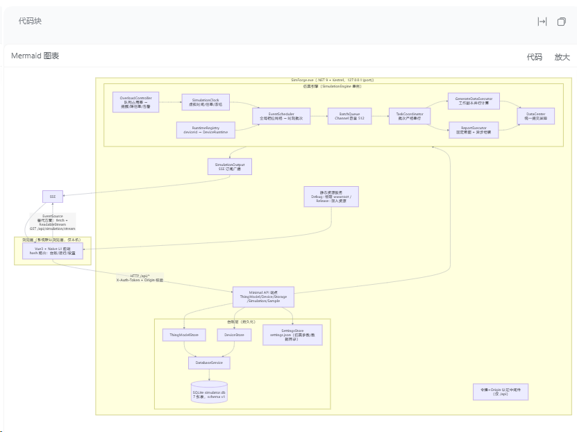
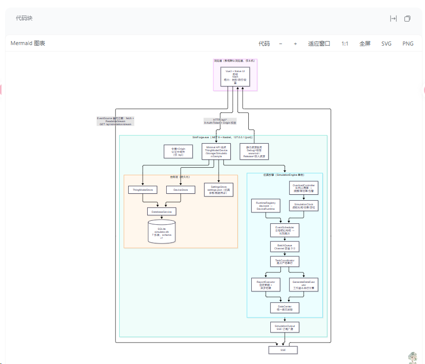
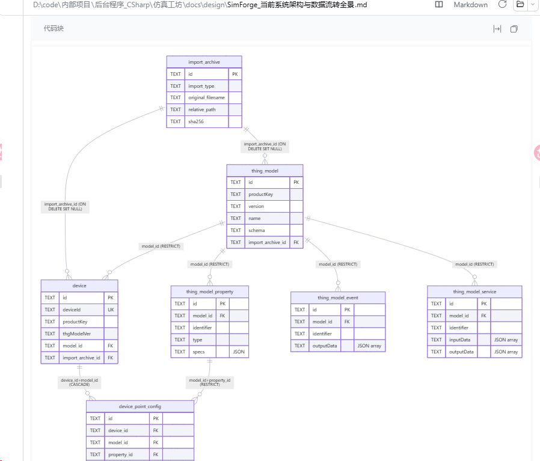
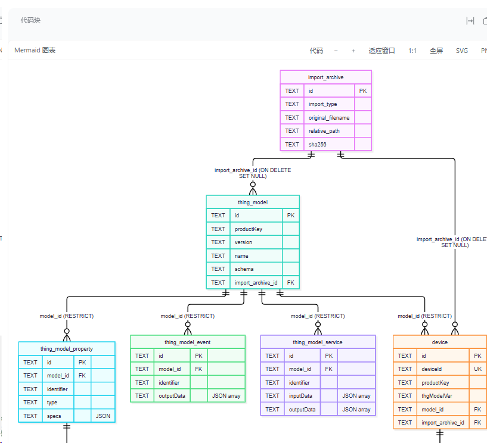
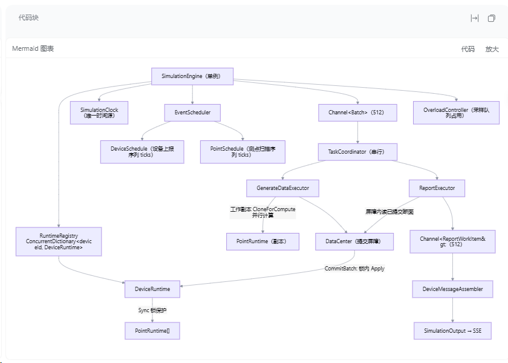
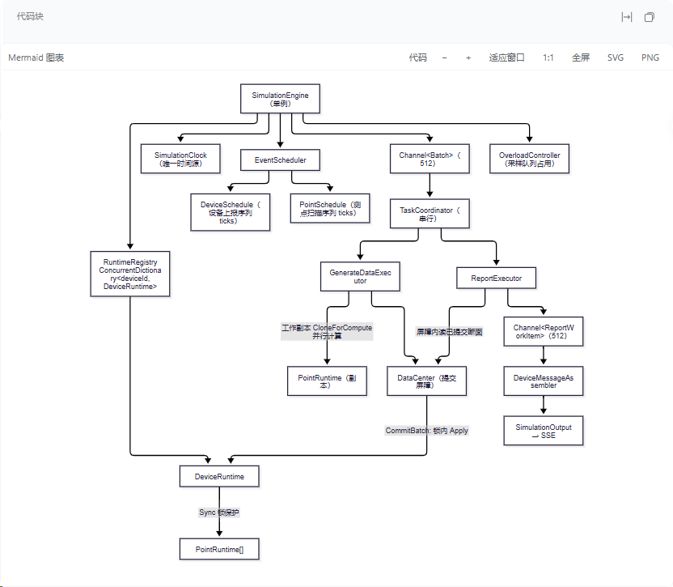
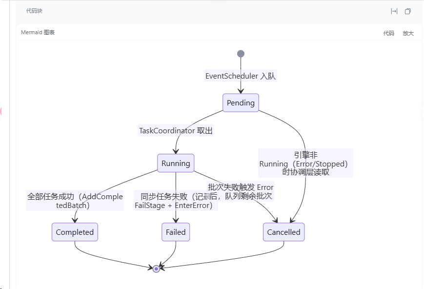
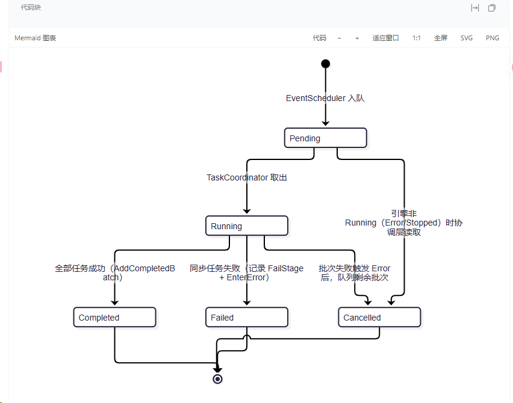
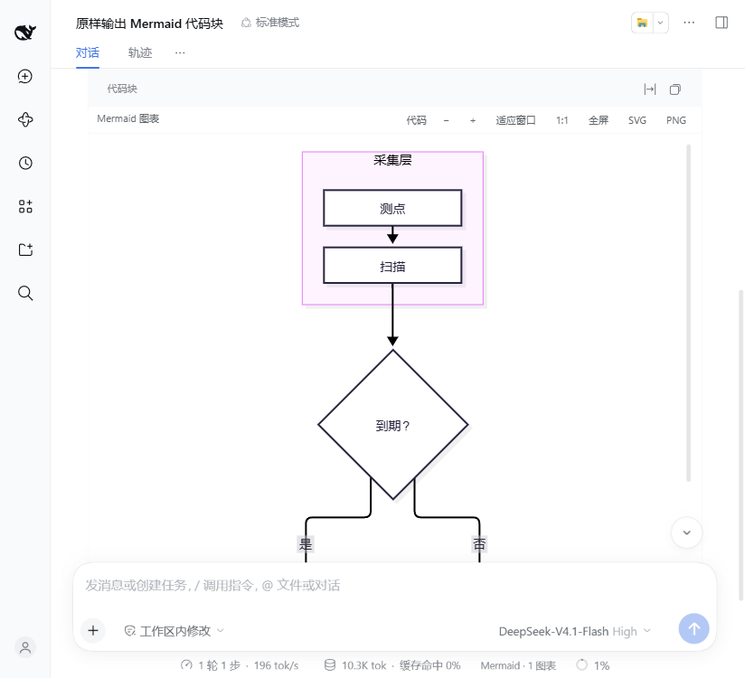

# dsh-mermaid-plus

[](https://www.npmjs.com/package/dsh-mermaid-plus)
[](LICENSE)
[](https://github.com/deepseek-ai/DeepSeek-Harness)
[](#install)

Mermaid diagrams for [DeepSeek Harness](https://github.com/deepseek-ai/DeepSeek-Harness) — rendered when they scroll into view, with inline zoom, drag to pan, fullscreen viewing, and SVG/PNG export.

[中文说明](#中文说明)

## Fork 来源与本次改造

本项目 Fork 自 **[pidongqianqian/dsh-mermaid-plus](https://github.com/pidongqianqian/dsh-mermaid-plus)**，原作者为 **pidongqianqian**，沿用 MIT 许可证。当前 Fork 为 [Songyanglin-curious/dsh-mermaid-plus](https://github.com/Songyanglin-curious/dsh-mermaid-plus)。上游提供了 DSH 集成、图表识别、三种渲染模式、源码切换、全屏查看、缓存及生命周期管理；本次在这些功能基础上改造渲染核心和图形交互。

当前版本为 **`0.5.3`**，适配 DSH `0.2.2-rc.5`；尚未发布到 npm；上方 npm 徽章及 npm 包名指向上游发行版，不代表本 Fork 的改造版本。

`0.4.1` 在 `0.4.0` 插槽修复与复杂图测试的基础上，明确声明客户端插槽提供方的加载依赖，同步 Mermaid 运行时版本查询标记，并支持通过 `DSH_RUNTIME_PACKAGE` 指定真实 DSH CLI 运行 Host 集成测试。`@deepseek-ai/dsh` 声明为可选 peer（由启动器提供），当时兼容版本固定为 `0.2.2-rc.1`，不另外安装一份 CLI。

| 改动 | 本 Fork 的行为 |
| --- | --- |
| 渲染核心 | Mermaid 从 11.17.0 升级并固定为 **12.2.0 完整版**，离线打包内置 ELK，不依赖 CDN。 |
| 布局与风格 | 默认 **ELK + Neo**，浅色使用 **Redux Color**，深色使用 **Redux Dark Color**；不再用 DSH 自定义节点配色覆盖官方主题。 |
| 默认展示 | 图表滚到可见处才渲染（视口内一次只渲染需要的），仍保留手动、立即两种模式与代码切换。旧版默认值不继承：设置里的选择会保存。 |
| 卡片工具栏 | 增加缩小、放大、适应窗口、1:1、全屏、SVG 和 PNG 导出。 |
| 鼠标操作 | 图形区域内滚轮围绕指针缩放，左键拖拽平移；区域外仍正常滚动页面。 |
| 显示与生命周期 | 按 SVG 原始比例设置占位尺寸，限制预览高度；缓存加入渲染配置版本，拒绝源码更新或卸载后的过期异步结果。 |
| 构建与安全 | esbuild JS API 兼容 Windows，保留 strict 安全模式和纯 SVG 标签；附带 Mermaid 与 ELK 许可证。 |

保留现有 DSH 插件架构，没有修改 DSH 核心，也没有通过改写用户 Mermaid 源码调整布局。不同图表的布局结果仍取决于图形结构和 Mermaid 配置，并非所有图形都会变得更小。

---

## 渲染效果对比

以下为本机 DSH 中的实际截图：左侧为上游原版 **0.2.6**，右侧为本 Fork **0.3.0-local.3**（渲染配置与 0.4.0 相同）。每组展示对应图表的改造前后效果。截图的视口、缩放和裁切范围不完全一致，用于观察布局、配色与工具栏差异，不作等比例尺寸或性能比较。

### 系统架构图

复杂嵌套子图从横向展开转为较集中的纵向层次，浏览器、台账层和仿真引擎的边界更容易辨认。

| 上游原版 | 本次改造 |
| --- | --- |
|  |  |

### 实体关系图

实体采用分组配色，关系连线和基数标记使用新的布局与视觉风格。此组截图仅展示局部，右侧部分内容被视口裁切。

| 上游原版 | 本次改造 |
| --- | --- |
|  |  |

### 仿真引擎图

调度、执行、提交和输出链路改用正交连线，分支与汇合关系呈现为更明确的执行层次。

| 上游原版 | 本次改造 |
| --- | --- |
|  |  |

### 状态图

状态节点、转换标签和终止状态采用新的样式与路径布局；改造版截图同时展示了卡片工具栏。

| 上游原版 | 本次改造 |
| --- | --- |
|  |  |

点击图片可查看原图。截图原件保存在 [docs/comparison](docs/comparison/index.md)，未重绘或修改图中内容。

0.4.0 适配 DSH `0.2.2-rc.1` 后的真机效果（对话中的图表卡片）：



## What it does

A fenced ` ```mermaid ` block in the conversation (or in a Markdown file preview) becomes a card:

- **On demand** — the source stays visible and a `Diagram` button waits in the card header. The offline Mermaid runtime is loaded only when requested.
- **When visible (default)** — a diagram renders the first time its card scrolls into view, so a long answer with many diagrams does not render them all at once.
- **Always** — renders when the source settles, then displays the diagram. Choices are saved per install.

The inline toolbar offers −, +, fit, 1:1, fullscreen, SVG, and PNG. Use the wheel inside the diagram viewport to zoom around the pointer, and left-drag to pan. Outside the viewport, the wheel scrolls the page normally. SVG preserves natural dimensions; PNG uses the current background with a maximum long edge of 8192 pixels.

Every rendered diagram can be opened **fullscreen** with zoom and pan, which is the point: a wide flowchart squeezed into the message column is unreadable, while the same diagram at natural size is fine.

## Features

- Renders `mermaid`, `mermaidjs`, `mmd` and unlabelled blocks that start with a diagram keyword.
- Supports the diagram types the bundled Mermaid build ships: `flowchart`/`graph`, `sequenceDiagram`, `classDiagram`, `stateDiagram`, `erDiagram`, `gantt`, `pie`, `mindmap`, `journey`, `timeline`, `quadrantChart`, `xychart`, `gitGraph`, `requirementDiagram`, `C4`, `block-beta`, `packet-beta`, `sankey-beta`, `kanban`, `architecture-beta`, and more.
- **Warm when idle**: the vendored runtime is fetched and parsed while the page is idle, so the first diagram pays only layout; manual mode and `save-data` connections skip the warm-up.
- **Isolated renderer**: layout runs in a minimal same-origin iframe, so the app's stylesheet and DOM cannot slow Mermaid's text measurement; if frames are blocked it falls back to in-page rendering.
- **Theme-aware**: uses official Redux Color / Redux Dark Color themes based on the app's light/dark mode; palette changes invalidate rendered diagrams.
- **Streaming-safe**: a block is handed to Mermaid only after its source settles, so a half-written fence never flashes a parse error.
- **Cached**: a rendered diagram is kept by source + palette, so switching between Code and Diagram, or reopening the viewer, costs nothing.
- **Fullscreen viewer**: wheel zoom, drag to pan, double-click to fit, `Esc` to close, focus-trapped dialog, restores focus and page scrolling.
- Falls back to the visible source with a short error line when a diagram does not parse.
- Unmounting restores every code block to its original place in the transcript.

## Install

### 从 GitHub Release 安装（推荐）

本 Fork 的安装包统一放在 [GitHub Releases](https://github.com/Songyanglin-curious/dsh-mermaid-plus/releases)，不提交到源码仓库。选择已发布版本，使用其 Assets 中的 TGZ 地址安装到 `web` Profile。当前发行版本为 `v0.5.3`：

```sh
dsh plugin --profile web add https://github.com/Songyanglin-curious/dsh-mermaid-plus/releases/download/v0.5.3/dsh-mermaid-plus-0.5.3.tgz
```

包内包含离线 Mermaid 运行时，无需克隆源码或构建。安装后重启对应 DSH Profile，并刷新浏览器页面：

```sh
dsh --profile web
dsh plugin --profile web list
```

确认列表中版本与所选 Release 一致。使用其他 Profile 时，将 `web` 换成实际名称，各 Profile 独立安装。

### 更新或替换旧版

从 Releases 选择新版本，将下面 URL 中的标签和文件版本同时替换为目标版本。已安装上游版、GitHub 源码版或旧本地包时，先移除同名插件，再安装 Release 包：

```sh
dsh plugin --profile web remove dsh-mermaid-plus
dsh plugin --profile web add https://github.com/Songyanglin-curious/dsh-mermaid-plus/releases/download/v0.5.3/dsh-mermaid-plus-0.5.3.tgz
```

重启 Profile、刷新页面，再用 `dsh plugin --profile web list` 核对版本。固定版本 URL 不会自动升级；回退时安装旧版本的 Release TGZ。

### 下载后本地安装

也可以从 Release 下载 TGZ 和 `SHA256SUMS.txt`，用 PowerShell 核对 SHA256 与清单一致后安装：

```powershell
Get-FileHash ./dsh-mermaid-plus-0.5.3.tgz -Algorithm SHA256
dsh plugin --profile web add ./dsh-mermaid-plus-0.5.3.tgz
```

开发者自行打包使用 `npm ci`、`npm run build`、`npm pack`；生成的 TGZ 不纳入 Git。

### 上游发行版

以下命令安装的是上游版本，不包含本 Fork 的改造：

```sh
dsh plugin --profile <profile> add dsh-mermaid-plus
```

Or install it from a catalog in **Settings → Plugins → Marketplace** (see the [DSH 1024Store](https://github.com/imsai-sh/awesome-deepseek-harness-plugins) listing). Restart the app or reload the page afterwards.

The Mermaid runtime is **bundled** with this Fork (`vendor/mermaid.esm.min.mjs`, Mermaid 12.2.0 including ELK) and served from the plugin's own Host route, so rendering needs no CDN. The fullscreen viewer and card never send diagram source anywhere.

## Settings

**Settings → General → Mermaid diagrams** offers the three modes. The choice is stored per page origin and is namespaced by package name, so it never collides with another diagram plugin.

## Compatibility

- Built and verified against DSH `0.2.2-rc.1` (host `webServer` route, client slots, and the rendered Markdown of that release).
- DSH is a developer preview: client plugin contracts, slot keys, and rendered Markdown can change between releases. This plugin decorates the rendered `<pre><code>` output, which is the part most likely to shift; if a release breaks it, the cards simply stop appearing and the code blocks stay intact.
- Requires a browser or Electron renderer with `IntersectionObserver` (used only in "when visible" mode) and `DOMParser`.

## How it works

- **Host half** (`index.js`) mounts one prefix route that serves the vendored Mermaid ES module. The route is derived from the package name (`/x-dsh-mermaid-plus`), so two diagram plugins can coexist.
- **Browser half** (`client.js`) is a normal DSH client bundle: it registers a root-scoped occupant on `shell.overlay` (which exists before any session), plus a status row and the settings row. It never imports Harness client packages and never touches the model's context.
- Because the shipped Markdown renderer exposes no code-block extension point, the browser half decorates the rendered output: it moves a mermaid `<pre>` into a card it owns, and puts it back on unmount. The original DOM node is preserved, so the transcript, copy, and select all keep working.

## Troubleshooting

The browser half reports lifecycle events to its Host half, which appends them to a bounded log:

```
<os tmp>/dsh-mermaid-plus/report.json
```

It records lifecycle events only — `start`, `apply-ok`, `apply-throw`, `adopted`, `render-ok`, `render-error`, `blocks-unmatched` — with counts, not document text: no diagram source, no file contents, no paths beyond the plugin's own. If diagrams stop appearing, that file plus the browser console (a failed import) usually identifies the cause.

## Development

The plugin has no build step for its own code: `index.js` and `client.js` run as they are. Only `vendor/mermaid.esm.min.mjs` is generated, and only when the bundled Mermaid version changes.

```sh
npm ci                      # mermaid 12.2.0, esbuild, jsdom
node build.mjs              # rebuild vendor/mermaid.esm.min.mjs
node test/run.mjs           # host route, real cordis mount, jsdom browser-half behaviour
node test/serve-e2e.mjs     # open http://127.0.0.1:8732/ (assertions) or /simforge.html (8 complex diagrams)
node test/render-page.mjs   # same eyeball page headless: verdict, per-diagram failures, optional screenshot
node tools/doctor.mjs       # activation, install mode, last browser events
node tools/dev-sync.mjs     # copy this checkout over an npm-installed copy
```

[`docs/development.md`](docs/development.md) covers the debug loop, what each symptom means, and the release flow.

### Rendering regression on a real document

Lift every Mermaid fence out of a document, render it with the shipped bundle in headless Chrome, and keep a screenshot:

```sh
node tools/extract-mermaid.mjs <doc.md> test/e2e/<name>.md   # verbatim copy, with headings and line numbers
node test/render-page.mjs --md=<name>.md --out=docs/<name>.png
```

Worked example — the SimForge architecture document has 9 Mermaid blocks:

```sh
node tools/extract-mermaid.mjs "D:\SimForge_当前系统架构与数据流转全景.md" test/e2e/simforge-panorama.md
node test/render-page.mjs --md=simforge-panorama.md --out=docs/simforge-panorama.png
# simforge.html?md=simforge-panorama.md: 9/9 rendered, 0 failed
```

That document used to fail on one diagram: its `Note` wrote `GenerateData[A:p1,p2; B:p3]`, and Mermaid treats an ASCII `;` inside a `sequenceDiagram` as a statement separator (`Parse error on line 15`). The source now uses a full-width `；`, so all nine render; the extractor still copies verbatim, which is how the defect surfaced in the first place. Result sheet: [docs/simforge-panorama.png](docs/simforge-panorama.png).

## License

MIT; the upstream author's copyright notice is retained in [LICENSE](LICENSE). Bundled Mermaid is MIT; see [vendor/mermaid.LICENSE](vendor/mermaid.LICENSE). Bundled ELK (elkjs) is EPL-2.0; see [vendor/elkjs.LICENSE](vendor/elkjs.LICENSE).

---

## 中文说明

把对话（以及 Markdown 预览）里的 ` ```mermaid ` 代码块渲染成图表卡片。

**默认滚到可见处才渲染**：图表进入视口时才渲染并展示，长回答里的多张图不会一起抢占运行时。设置里可切到「立即」或「手动」。卡片保留「代码」切换，并提供缩小、放大、适应窗口、1:1、全屏、SVG 和 PNG 导出。鼠标在图形区域内时，滚轮缩放、左键拖拽平移；区域外正常滚动页面。

渲染后的图表可以**全屏放大**：滚轮缩放、拖动平移、双击适应窗口、`Esc` 关闭；全屏只克隆已有 SVG，不会重新渲染。

其他特性：

- 采用 Mermaid 官方 Redux Color / Redux Dark Color 配色，随应用明暗模式切换，不再注入 DSH 的自定义节点颜色。
- 页面空闲时预热运行时（手动模式与 `save-data` 连接跳过），第一张图只需付布局的时间。
- 渲染跑在独立的最小同源 iframe 里，宿主页面的样式表与 DOM 不再拖慢 Mermaid 的测量；iframe 被拦截时自动回退到页内渲染。
- 流式输出期间不会渲染半截源码。
- 渲染结果按「配色 + 源码」缓存，切换「代码/图形」或重开全屏都是零成本。
- 解析失败时保留源码并给一行错误提示。
- 卸载时把每个代码块放回原位，不破坏对话内容。

模式开关在 **设置 → 通用 → Mermaid 图表**。Mermaid 12.2.0 完整版与 ELK 随包内置，由插件自己的 Host 路由提供，**不访问 CDN**，图表源码不会发往远程渲染服务。

兼容 DSH `0.2.2-rc.5`。DSH 处于开发者预览阶段，客户端插件契约可能变化；本插件装饰渲染后的 `<pre><code>`，是最容易受影响的一层——若某次升级后卡片不再出现，代码块本身仍然完好。

排障：浏览器半侧会把生命周期事件报告给 Host，写入 `<系统临时目录>/dsh-mermaid-plus/report.json`（`start` / `adopted` / `render-ok` / `render-error` / `apply-ok` / `apply-throw`）。

## 用真实文档做渲染回归

`tools/extract-mermaid.mjs` 把一个 Markdown 里的 mermaid 代码块逐字抽成测试集（保留小节标题与行号），`test/render-page.mjs` 用出货的 `client.js` 在无头 Chrome 里渲染并给出判定：

```sh
node tools/extract-mermaid.mjs <文档.md> test/e2e/<名字>.md
node test/render-page.mjs --md=<名字>.md --out=docs/<名字>.png
```

仓库里的例子是《SimForge_当前系统架构与数据流转全景》的 9 张图（`test/e2e/simforge-panorama.md`）：

```sh
node test/render-page.mjs --md=simforge-panorama.md --out=docs/simforge-panorama.png
# simforge.html?md=simforge-panorama.md: 9/9 rendered, 0 failed
```

这份文档以前有一张图渲染失败：`Note` 里 `GenerateData[A:p1,p2; B:p3]` 用了半角 `;`，Mermaid 在 `sequenceDiagram` 中把它当语句分隔符（`Parse error on line 15`）。原文已改成全角 `；`，现在 9 张全部通过；抽取工具坚持逐字复制，也正是这个缺陷当初能被发现的原因。整页结果：[docs/simforge-panorama.png](docs/simforge-panorama.png)。
