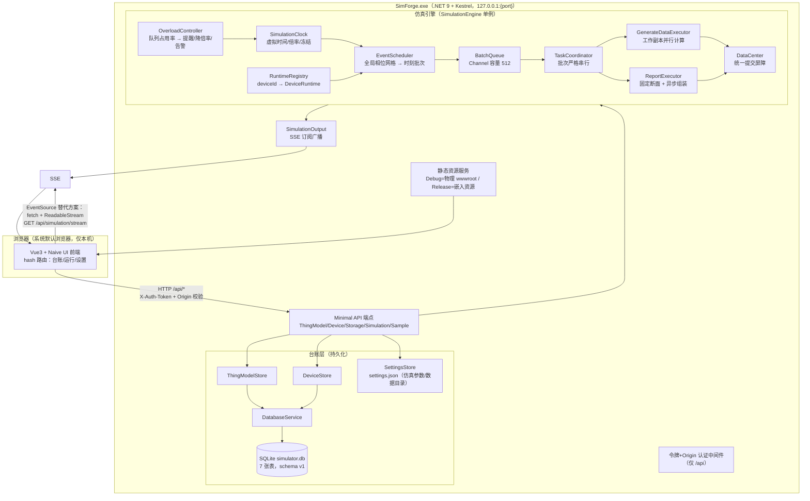
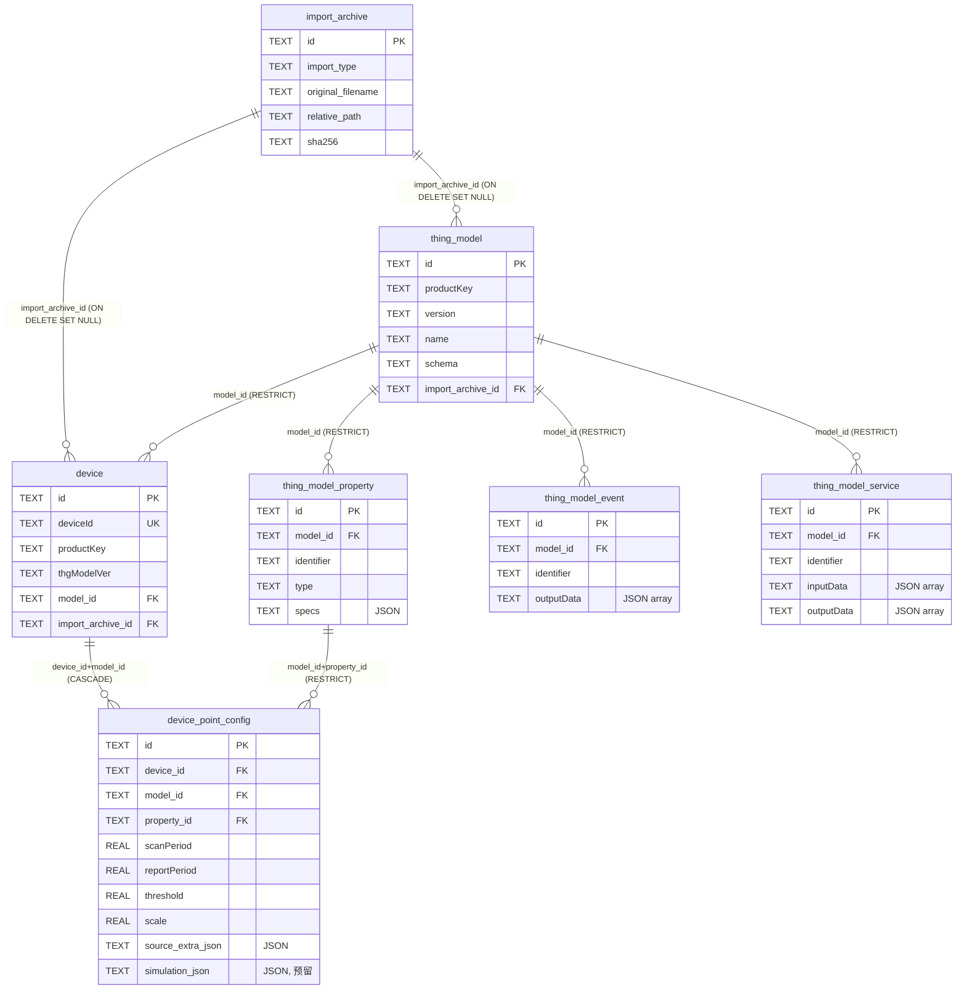
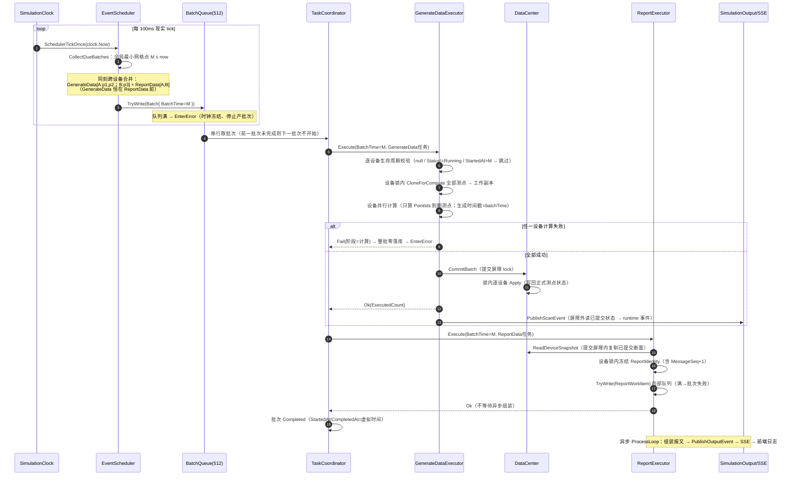
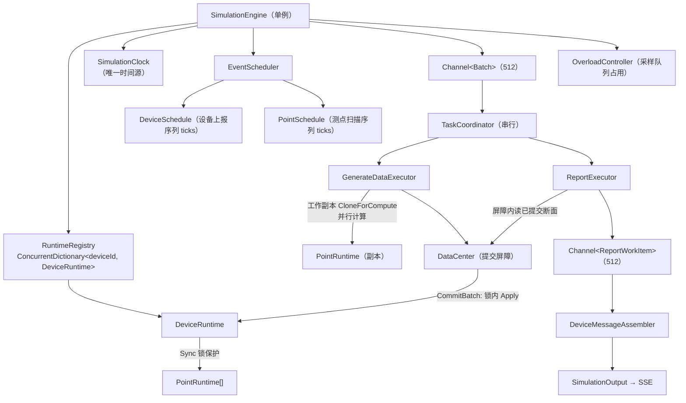
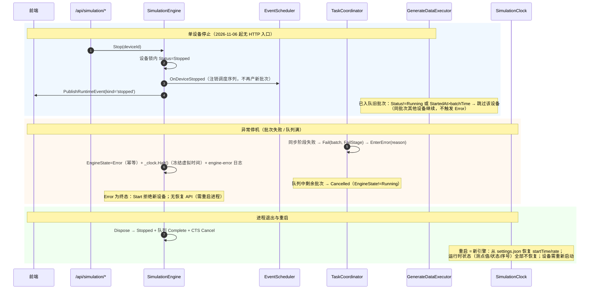
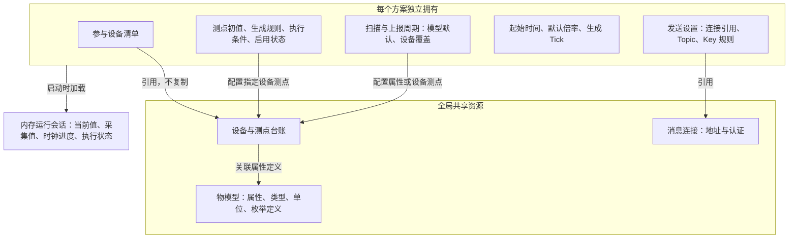
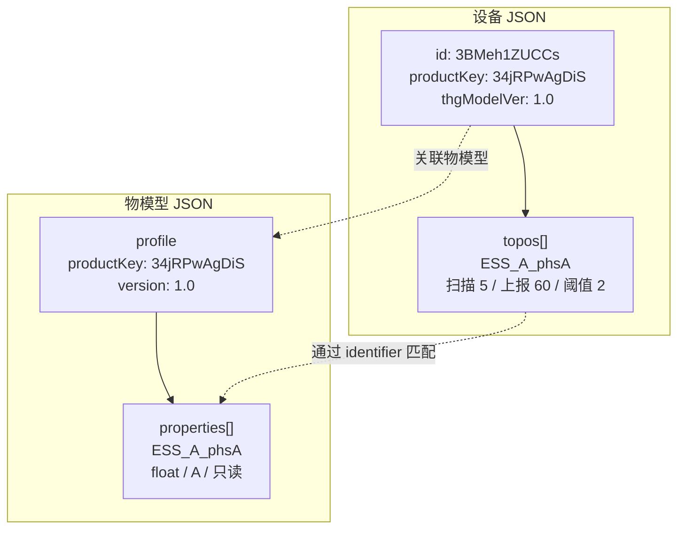
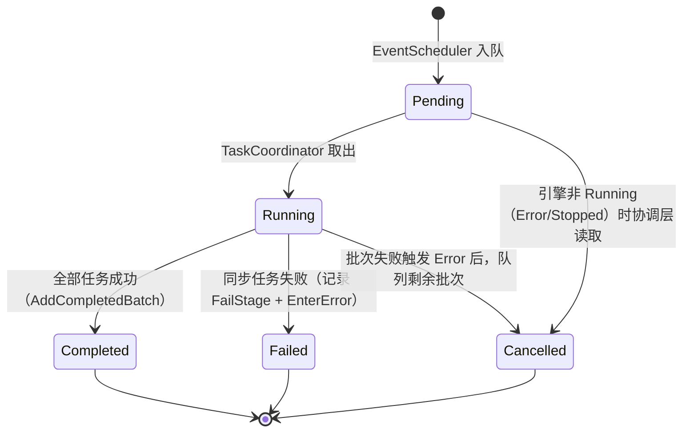

# SimForge 复杂 Mermaid 集成测试集

从 `D:\code\SimForge\docs` 抽取的 8 张复杂图，用于在本地验证 dsh-mermaid-plus 的渲染、主题适配、缩放与全屏查看器。每张图下方标注了原始出处：其中 6 张出自《SimForge_当前系统架构与数据流转全景.md》的新版（`docs/design/current/`），2 张出自 `docs/guide/资源归属.md` 与 `docs/articles/drafts/01-从Mock数据到设备仿真.md`。

> **这份不是逐字提炼**：图块统一重排了缩进；流程 D 的 `Note` 里原文是半角分号（`GenerateData[A:p1,p2; B:p3]`），Mermaid 会把它当语句分隔符而解析失败，这里用的是全角 `；`。原文已于 2026-11-15 改成全角，逐字版本见 [`simforge-panorama.md`](simforge-panorama.md)（9 张，现已全部渲染通过）。

> 用途：`node test/serve-e2e.mjs` 后在浏览器打开 `http://127.0.0.1:8732/simforge.html`
> 也能作为普通 Markdown 在 DSH 的文档预览里直接查看（插件会装饰任何 `<pre>` 里的 Mermaid）。

---

## SimForge 系统架构全景（flowchart + 4 subgraph，20 节点）

来源：`docs/design/current/SimForge_当前系统架构与数据流转全景.md` 第 114 行

---

## SQLite 7 表实体关系（erDiagram，11 实体）

来源：`docs/design/current/SimForge_当前系统架构与数据流转全景.md` 第 280 行

---

## 仿真 tick 批次链路（sequenceDiagram，8 参与者，loop/alt/Note）

来源：`docs/design/current/SimForge_当前系统架构与数据流转全景.md` 第 548 行

---

## 仿真引擎对象图（flowchart，19 条边、含 HTML 实体 &lt; &gt;）

来源：`docs/design/current/SimForge_当前系统架构与数据流转全景.md` 第 443 行

---

## 启停与异常停机时序（sequenceDiagram，rect 分组）

来源：`docs/design/current/SimForge_当前系统架构与数据流转全景.md` 第 650 行

---

## 全局共享资源与方案资源归属（flowchart + subgraph 跨图连线）

来源：`docs/guide/资源归属.md` 第 11 行

---

## 物模型与设备 JSON 关联（flowchart，虚线带标签 + direction TB）

来源：`docs/articles/drafts/01-从Mock数据到设备仿真.md` 第 93 行

---

## 批次状态机（stateDiagram-v2）

来源：`docs/design/current/SimForge_当前系统架构与数据流转全景.md` 第 786 行

