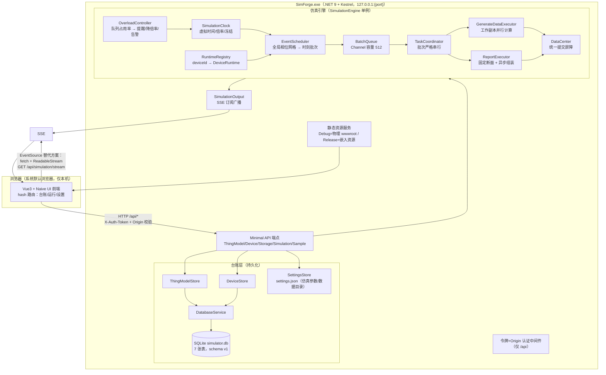
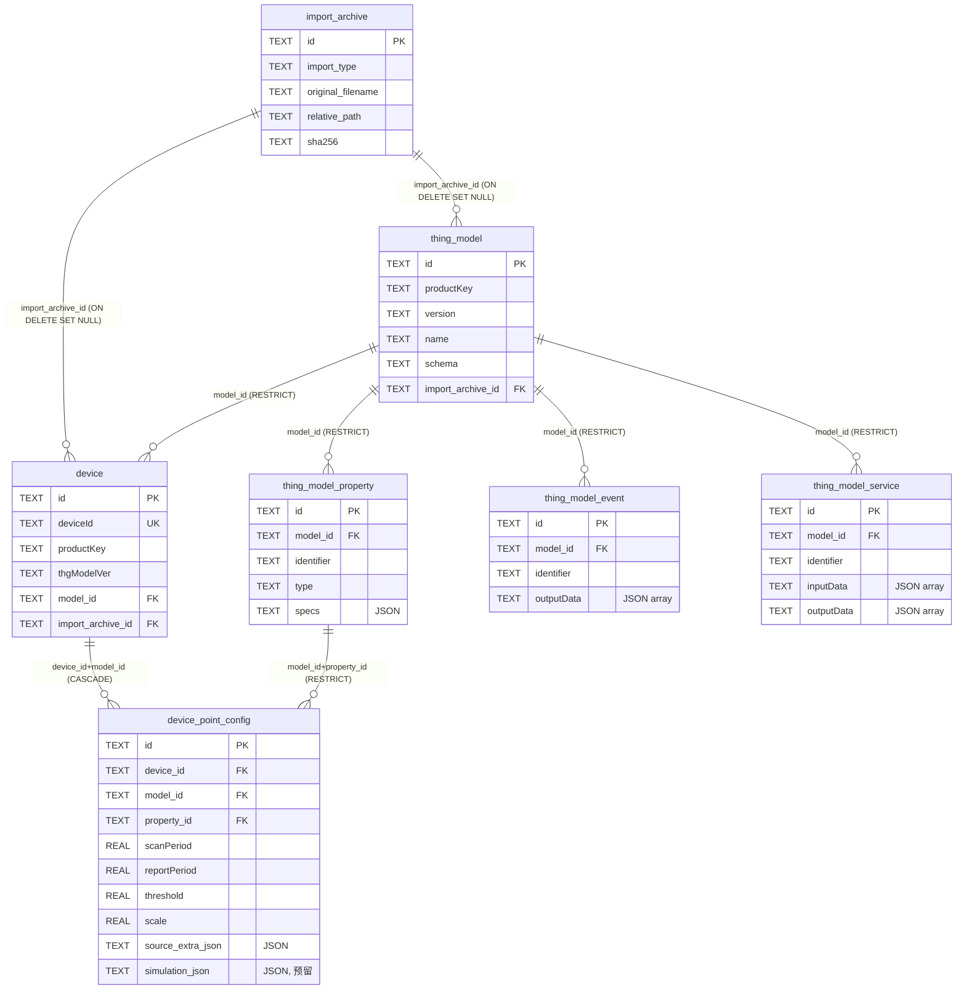
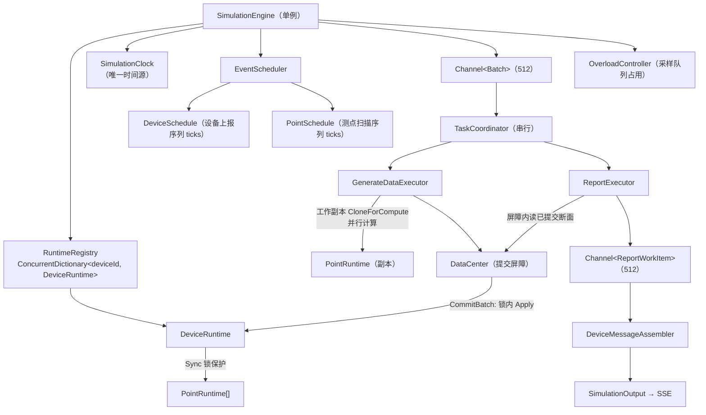
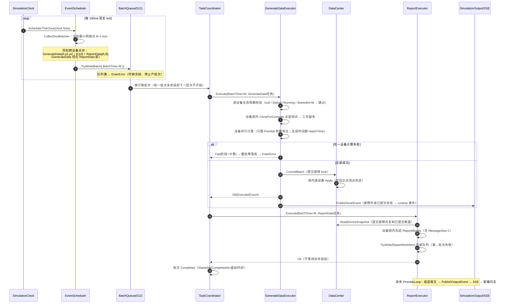
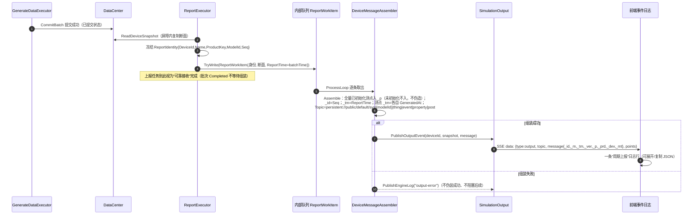
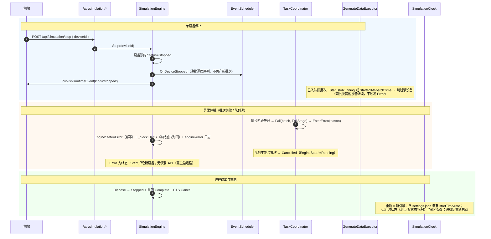
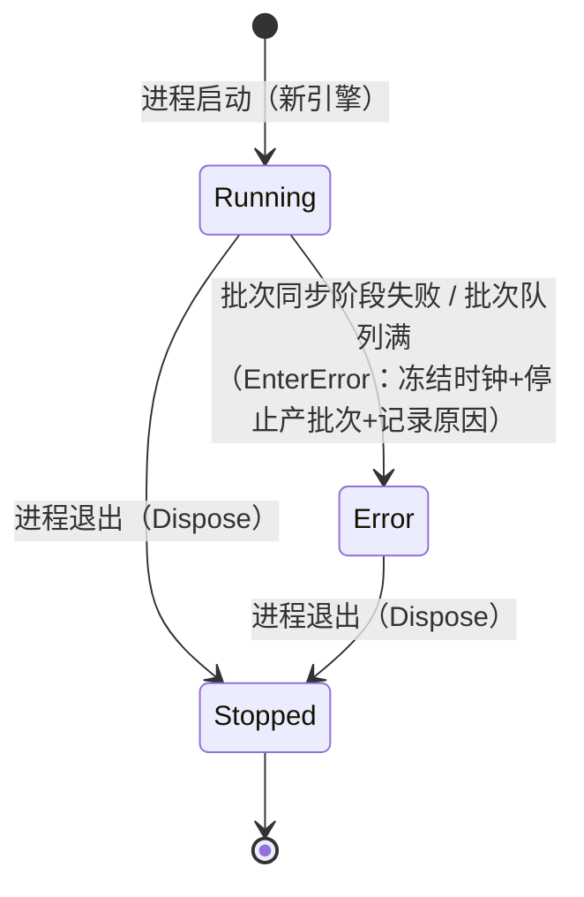
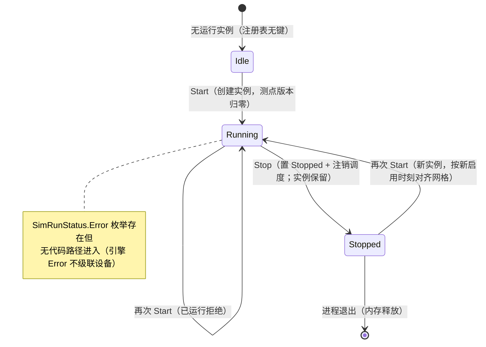
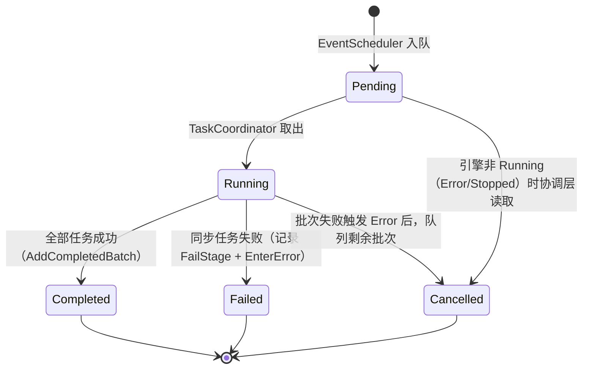

# SimForge_当前系统架构与数据流转全景 · Mermaid 图集

从 `D:\SimForge_当前系统架构与数据流转全景.md` 逐块提炼的 9 张 Mermaid 图，供 `test/e2e/simforge.html` 用出货的 `client.js` 渲染验证。

> 本文件由 `node tools/extract-mermaid.mjs` 生成，重新提炼时整份覆盖，不要手改图源。

> 图块内容与原文逐字一致；每块下方标注原文标题与行号（1-based，行号指 ```mermaid 围栏所在行）。

---

## 1. 3.3 系统整体架构图（flowchart）
来源：`D:\SimForge_当前系统架构与数据流转全景.md` 第 112 行（小节标题在第 110 行）




## 2. 4.1.5 领域关系图（erDiagram）
来源：`D:\SimForge_当前系统架构与数据流转全景.md` 第 278 行（小节标题在第 276 行）




## 3. 4.3.3 运行时对象关系图（flowchart）
来源：`D:\SimForge_当前系统架构与数据流转全景.md` 第 441 行（小节标题在第 439 行）




## 4. 流程 D：一次完整的仿真批次（重点）（sequenceDiagram）
来源：`D:\SimForge_当前系统架构与数据流转全景.md` 第 544 行（小节标题在第 540 行）




## 5. 流程 E：上报报文与前端日志（sequenceDiagram）
来源：`D:\SimForge_当前系统架构与数据流转全景.md` 第 599 行（小节标题在第 597 行）




## 6. 流程 G：设备停止、重启与异常停机（sequenceDiagram）
来源：`D:\SimForge_当前系统架构与数据流转全景.md` 第 646 行（小节标题在第 644 行）




## 7. 引擎状态（stateDiagram-v2）
来源：`D:\SimForge_当前系统架构与数据流转全景.md` 第 760 行（小节标题在第 758 行）




## 8. 设备状态（stateDiagram-v2）
来源：`D:\SimForge_当前系统架构与数据流转全景.md` 第 771 行（小节标题在第 769 行）




## 9. 批次状态（stateDiagram-v2）
来源：`D:\SimForge_当前系统架构与数据流转全景.md` 第 784 行（小节标题在第 782 行）



